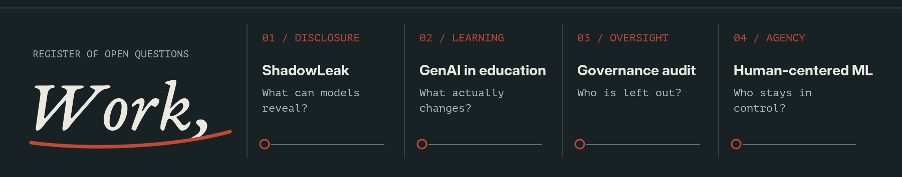

<!--
YOGESH LUITEL — MARGINS OF ERROR
Profile README for github.com/yogesh0224.
All image assets are committed locally. No remote badges, animation services, or stats dependencies.
-->

I teach computer science at Xavier International College in Nepal. I also build research prototypes and software systems, mostly around the places where AI meets people: learning, privacy, institutional decisions, and the ability to question an automated result.

My projects move between experimentation and engineering. I am interested in **what systems actually do**, **how we know**, and **whether people can meaningfully challenge them**.

01 / PRIVACY · LANGUAGE MODELS

### [ShadowLeak ↗](https://github.com/yogesh0224/shadowleak)

**Can a language model be induced to disclose sensitive information placed in its context?**

A reproducible framework for studying contextual disclosure with synthetic records, adversarial prompts, and multiple leakage-detection approaches. The experimental and annotation work is ongoing; this is not a claim of a completed or published study.

02 / LEARNING · GENERATIVE AI

### [Generative AI & Student Learning ↗](https://github.com/yogesh0224/genai-education-research)

**How should we study AI-assisted learning beyond model performance?**

A research platform for examining relationships between generative-AI use and student outcomes. It combines analysis workflows, NLP-derived features, machine-learning baselines, clustering, and statistical evaluation.

03 / ACCOUNTABILITY · EDUCATIONAL ML

### [Educational AI Governance Audit Toolkit ↗](https://github.com/yogesh0224/educational-ai-governance-audit-toolkit)

**What does an accuracy score leave out?**

An auditing toolkit that brings together predictive performance, subgroup evaluation, explainability, and governance-risk documentation for educational machine-learning systems.

04 / HUMAN AGENCY · LEARNING TO PROGRAM

### [Human-Centered ML for Programming Misconceptions ↗](https://github.com/yogesh0224/hci-ml-misconceptions)

**Can a model help a teacher without taking the decision away?**

A teacher-facing research prototype with uncertainty indicators, explanations, counterfactual suggestions, and human correction. A small controlled pilot compares ML-assisted and unassisted review.

ANOTHER LINE OF INQUIRY / SECURITY

### [HUMANPASS ↗](https://github.com/yogesh0224/humanpass-continuous-auth)

An experimental continuous-authentication system exploring behavioral signals, adaptive risk, step-up verification, and session revocation. A research prototype, not a production security guarantee.

BEYOND THE REPOSITORIES

### In the classroom / in the codebase

I teach programming and computer science to Grade 11 and 12 students. My applied engineering work includes Django applications, REST APIs, authentication and authorization, secure multi-user workflows, and testing. I also mentor students through real software work: debugging, reviewing, and maintaining code together.

MY WORKBENCH

**Languages and systems:** Python, JavaScript, SQL, Django, REST APIs, Linux, Git.

**Research practice:** empirical evaluation, statistical analysis, NLP, model assessment, subgroup analysis, explainability, privacy-leakage evaluation. Tools include pandas, NumPy, SciPy, scikit-learn, and SentenceTransformers.

OPEN A CONVERSATION

[Email me ↗](mailto:yogeshluitel9@gmail.com) · [Browse the repositories ↗](https://github.com/yogesh0224?tab=repositories)

Based in Nepal. Research, teaching, and software in progress.
