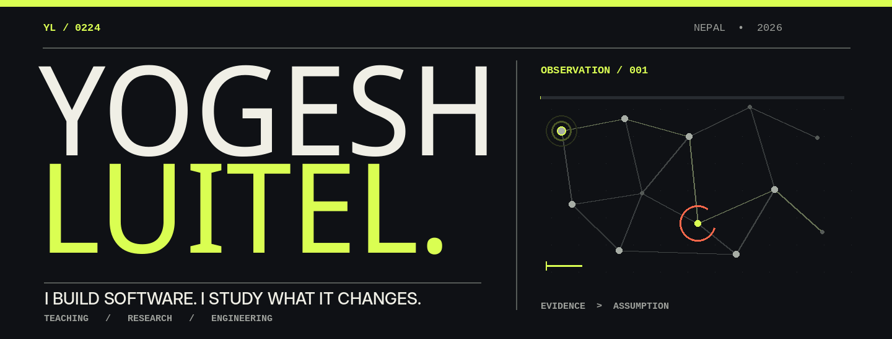

<!--
YOGESH LUITEL / OBSERVATION FIELD V4
One animated observation system, two focused research investigations.
GIFs generated locally in this repository by scripts/build_profile.py.
No analytics counters, third-party badges, image APIs, or hosted font dependencies.
-->

<picture>
  <source media="(max-width: 680px)" srcset="assets/hero-mobile.gif" />
  
</picture>

I'm Yogesh. In the classroom, I teach people how software works. Outside it, I investigate what software does to people. I build prototypes, test their behavior, and document what the evidence can, and cannot, say.

SELECTED INVESTIGATIONS &nbsp; / &nbsp; 02

### 01 &nbsp; [SHADOWLEAK ↗](https://github.com/yogesh0224/shadowleak)

*Privacy under adversarial prompting.* A reproducible framework that tests whether language models disclose information supplied in synthetic contexts. The experiment and evidence collection are real; independent annotation and publication are not yet complete.

### 02 &nbsp; [HUMAN-CENTERED ML ↗](https://github.com/yogesh0224/hci-ml-misconceptions)

*Machine learning that leaves the teacher in charge.* An experimental tool for identifying programming misconceptions with explanations, uncertainty, and human correction. A small pilot explored ML-assisted versus unassisted review.

THE REST OF THE STORY

I teach Grade 11–12 computer science at Xavier International College in Nepal. I also engineer Django systems and work with Python, SQL, JavaScript, and empirical ML evaluation. The classroom and the codebase keep informing each other.

[**Explore the code ↗**](https://github.com/yogesh0224?tab=repositories) &nbsp;&nbsp;·&nbsp;&nbsp; [**Get in touch ↗**](mailto:yogeshluitel9@gmail.com)
