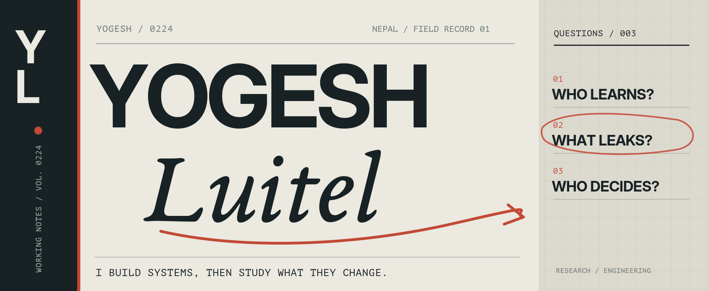
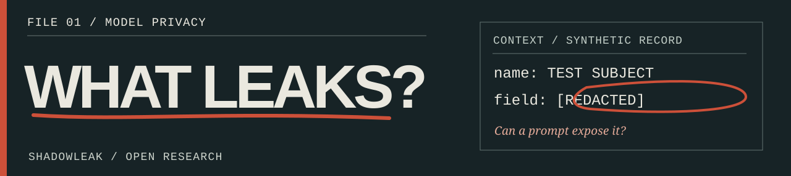
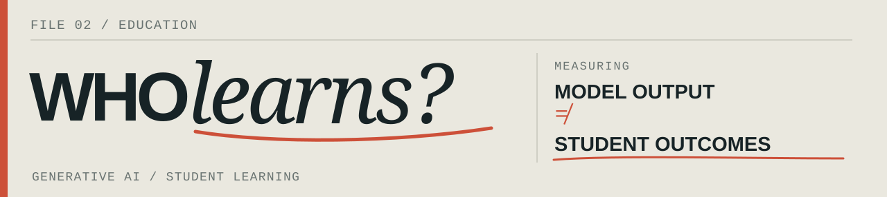
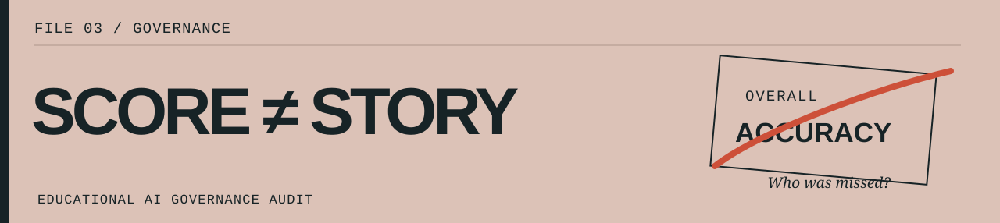
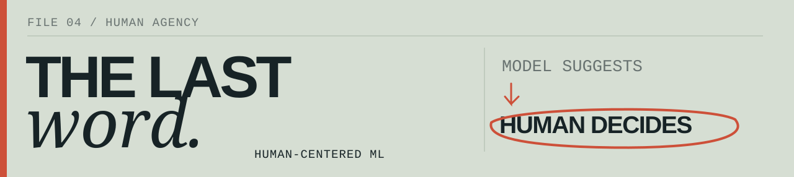

<!--
YOGESH LUITEL / MARGINS OF ERROR — RESEARCH ARCHIVE
The four research plates are locally stored SVGs. Each is a linked image
with descriptive alt text and a readable HTML/Markdown caption.
No external badge, font, animation or statistics services required.
-->

I teach computer science. I build systems. Then I investigate what changes when people use them — especially around **learning, privacy, accountability, and human judgment**.

OPEN FILES / 01—04 &nbsp;·&nbsp; SELECT A PLATE TO EXPLORE THE WORK

**ShadowLeak.** Synthetic records, adversarial prompts, and reproducible leakage checks. The study's independent annotation and publication work remain unfinished.

**Generative AI & Student Learning.** A research platform examining learning outcomes through NLP-derived features, machine-learning baselines, and statistical analysis.

**Educational AI Governance Audit Toolkit.** Looking beyond aggregate scores through subgroup evaluation, explainability, and governance-risk documentation.

**Human-Centered ML for Programming Misconceptions.** A teacher-facing prototype with explanations, uncertainty signals, human correction, and a small controlled pilot.

IN THE MARGINS / ANOTHER EXPERIMENT

[HUMANPASS ↗](https://github.com/yogesh0224/humanpass-continuous-auth) explores continuous authentication using behavioral signals and adaptive risk controls. It is a research prototype, not a production security guarantee.

AWAY FROM THE EXPERIMENTS

I teach Grade 11 and 12 computer science at Xavier International College in Nepal, and mentor students through debugging, code review, and real software projects. My engineering work spans Django, REST APIs, databases, authentication, authorization, and testing.

For research, I use Python, SQL, pandas, SciPy, scikit-learn, and NLP tools. Methods matter as much as implementations: empirical evaluation, subgroup analysis, reproducibility, and clear boundaries around what results can establish.

WRITE A NOTE / START A CONVERSATION

[yogeshluitel9@gmail.com](mailto:yogeshluitel9@gmail.com) &nbsp;·&nbsp; [All repositories ↗](https://github.com/yogesh0224?tab=repositories)

YOGESH LUITEL &nbsp; / &nbsp; NEPAL &nbsp; / &nbsp; RESEARCH, TEACHING, SOFTWARE.
